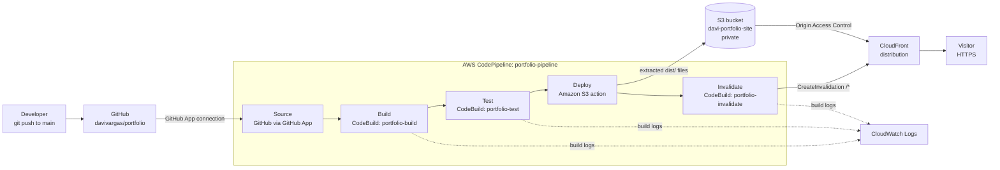

# AWS CI/CD Pipeline

This document describes the AWS pipeline that tests, builds, and deploys this portfolio. Every push to `main` on GitHub flows through AWS CodePipeline. It ends on a private S3 bucket served through Amazon CloudFront.

Live site: https://d2hawg7iu43gf8.cloudfront.net

## Contents

1. [Architecture](#1-architecture)
2. [Feature status](#2-feature-status)
3. [Resource inventory](#3-resource-inventory)
4. [Pipeline stages](#4-pipeline-stages)
5. [Configuration files](#5-configuration-files)
6. [Setup guide](#6-setup-guide)
7. [Maintenance](#7-maintenance)
8. [Troubleshooting](#8-troubleshooting)
9. [Clean-up](#9-clean-up)

## 1. Architecture



How a change reaches visitors:

1. A push to `main` notifies CodePipeline through the GitHub App connection.
2. **Source** downloads that commit as a zip, called `SourceArtifact`.
3. **Build** runs `npm run build` and emits the static site as `BuildArtifact`.
4. **Test** runs lint, the TypeScript type check, and the Vitest suite against the source. A failure stops the pipeline before anything is deployed.
5. **Deploy** extracts `BuildArtifact` into the root of the S3 bucket.
6. **Invalidate** clears the CloudFront cache, so visitors get the new version right away instead of after the cache expires.

The bucket is never public. CloudFront reads it through an Origin Access Control (OAC), and the bucket policy only allows reads signed by this one distribution.

The repository also keeps its original GitHub Actions workflow, `.github/workflows/deploy.yml`, which publishes the same build to GitHub Pages. The two deployments are independent. Disabling one does not affect the other.

## 2. Feature status

| Requirement | Status | Implementation |
|---|---|---|
| Website showing the resume | Done | React single-page site with experience, projects, education, skills, and a downloadable resume PDF |
| Infrastructure | Done | S3 static hosting behind CloudFront with HTTPS |
| Version control and `.gitignore` | Done | GitHub repository. `.gitignore` excludes `node_modules`, `dist`, logs, and editor files. |
| Pipeline watches the repository | Done | CodePipeline V2 source action on `main` through a GitHub App connection |
| Build stage | Done | CodeBuild project `portfolio-build` |
| Test stage | Done | CodeBuild project `portfolio-test` runs ESLint, `tsc`, and Vitest. |
| Deploy stage | Done | CodePipeline Amazon S3 deploy action, followed by a CloudFront cache invalidation |
| Automated tests (optional) | Done | Vitest with React Testing Library. Tests check that resume sections render, expand, open details, and offer the PDF. |
| Monitoring and logging (optional) | Partial | All CodeBuild output goes to CloudWatch Logs. CloudWatch alarms and notifications were not set up. |
| Documentation | Done | This file |

Not implemented:

- CloudWatch alarms and SNS notifications.
- Browser end-to-end tests such as Selenium. The automated tests render components in a simulated DOM (jsdom) rather than a real browser.
- A custom domain. The site uses the default CloudFront domain.
- Infrastructure as code. Resources were created in the AWS console following section 6.

## 3. Resource inventory

All resources are in **us-east-1 (N. Virginia)**. CloudFront itself is global, but its metrics live in us-east-1, so everything else was placed there too.

| Resource | Name or ID | Notes |
|---|---|---|
| S3 bucket (site) | `davi-portfolio-site` | Block Public Access on, ACLs disabled |
| CloudFront distribution | `E3JVVRLEONZ3YA` | Domain `d2hawg7iu43gf8.cloudfront.net`, Free pricing plan |
| Origin Access Control | Attached to the distribution's S3 origin | Signs CloudFront's requests to S3 |
| CodeConnections connection | `github-portfolio` | Provider GitHub, status Available |
| CodePipeline | `portfolio-pipeline` | Type V2, execution mode Queued |
| CodeBuild project | `portfolio-build` | Reads `buildspec.yml` |
| CodeBuild project | `portfolio-test` | Reads `buildspec-test.yml` |
| CodeBuild project | `portfolio-invalidate` | Reads `buildspec-invalidate.yml`, env var `DISTRIBUTION_ID` |
| S3 bucket (artifacts) | `codepipeline-us-east-1-<random>` | Created by the pipeline wizard |
| IAM roles | `AWSCodePipelineServiceRole-us-east-1-portfolio-pipeline`, `codebuild-portfolio-*-service-role` | Created by the wizards |
| CloudWatch log groups | `/aws/codebuild/portfolio-build`, `-test`, `-invalidate` | Created on first run |

## 4. Pipeline stages

| Stage | Provider | Input artifact | Output artifact | What it does |
|---|---|---|---|---|
| Source | GitHub (via GitHub App) | none | `SourceArtifact` | Downloads the pushed commit from `main` |
| Build | AWS CodeBuild, `portfolio-build` | `SourceArtifact` | `BuildArtifact` | `npm ci`, `npm run build`, and packages `dist/` |
| Test | AWS CodeBuild, `portfolio-test` | `SourceArtifact` | none | `npm ci`, ESLint, `tsc --noEmit`, Vitest |
| Deploy | Amazon S3 | `BuildArtifact` | none | Extracts the site into the bucket root |
| Invalidate | AWS CodeBuild, `portfolio-invalidate` | `SourceArtifact` | none | Invalidates `/*` on the distribution |

Test and Invalidate must take `SourceArtifact`, because their buildspec files live in the source code. `BuildArtifact` contains only the built site.

Test runs after Build but before Deploy, so a failing test still blocks deployment.

## 5. Configuration files

The files in the repository root are the source of truth. Their contents are summarised here.

### `buildspec.yml` (Build stage)

```yaml
version: 0.2
phases:
  install:
    runtime-versions:
      nodejs: 20
    commands:
      - npm ci
  build:
    commands:
      - npm run build
      - cp dist/index.html dist/404.html
artifacts:
  base-directory: dist
  files:
    - '**/*'
```

`base-directory: dist` makes the artifact contain the site files themselves, not a `dist/` folder, so `index.html` lands at the bucket root. The resume PDF is committed under `public/` and copied into `dist/` by Vite. No LaTeX toolchain is needed in CodeBuild.

### `buildspec-test.yml` (Test stage)

```yaml
version: 0.2
phases:
  install:
    runtime-versions:
      nodejs: 20
    commands:
      - npm ci
  build:
    commands:
      - npm run lint
      - npx tsc --noEmit -p tsconfig.app.json
      - npm run test
```

Any non-zero exit code fails the stage and stops the pipeline. Lint warnings do not fail the build. Lint errors do.

### `buildspec-invalidate.yml` (Invalidate stage)

```yaml
version: 0.2
phases:
  build:
    commands:
      - aws cloudfront create-invalidation --distribution-id "$DISTRIBUTION_ID" --paths "/*"
```

### CloudFront settings

| Setting | Value | Reason |
|---|---|---|
| Origin | `davi-portfolio-site` S3 bucket with OAC | Keeps the bucket private |
| Default root object | `index.html` | Serves the site at `/` |
| Viewer protocol policy | Redirect HTTP to HTTPS | |
| Custom error response 403 | `/index.html`, HTTP 200, TTL 10 s | S3 returns 403 for missing keys under OAC. The React router then handles the path. |
| Custom error response 404 | `/index.html`, HTTP 200, TTL 10 s | Same reason |

### S3 bucket policy

Written by CloudFront when the origin was created with private access. The account ID is redacted here.

```json
{
  "Version": "2008-10-17",
  "Id": "PolicyForCloudFrontPrivateContent",
  "Statement": [
    {
      "Sid": "AllowCloudFrontServicePrincipal",
      "Effect": "Allow",
      "Principal": { "Service": "cloudfront.amazonaws.com" },
      "Action": "s3:GetObject",
      "Resource": "arn:aws:s3:::davi-portfolio-site/*",
      "Condition": {
        "ArnLike": {
          "AWS:SourceArn": "arn:aws:cloudfront::<account-id>:distribution/E3JVVRLEONZ3YA"
        }
      }
    }
  ]
}
```

### IAM inline policy on `codebuild-portfolio-invalidate-service-role`

```json
{
  "Version": "2012-10-17",
  "Statement": [
    {
      "Effect": "Allow",
      "Action": "cloudfront:CreateInvalidation",
      "Resource": "arn:aws:cloudfront::<account-id>:distribution/E3JVVRLEONZ3YA"
    }
  ]
}
```

The wizard-generated CodeBuild roles already allow writing to CloudWatch Logs and reading the `codepipeline-us-east-1-*` artifact bucket.

## 6. Setup guide

Use the region **United States (N. Virginia) us-east-1** for every step except CloudFront, which is global.

### 6.1 Repository

1. Make sure `buildspec.yml`, `buildspec-test.yml`, and `buildspec-invalidate.yml` are in the repository root on `main`.
2. Make sure `npm run test` and `npm run build` pass locally.
3. Leave `BASE_PATH` unset. CloudFront serves the site from `/`, which is the Vite default.

### 6.2 S3 bucket

1. In S3, create a bucket named `davi-portfolio-site` in us-east-1.
2. Keep **Block all public access** on and **ACLs disabled**.
3. Do not enable static website hosting.

### 6.3 CloudFront distribution

1. Create a distribution with the S3 bucket as its origin, choosing private bucket access through Origin Access Control. CloudFront adds the bucket policy shown in section 5.
2. Do not enable paid WAF protections.
3. On the **General** tab, set **Default root object** to `index.html`.
4. On the **Error pages** tab, add the 403 and 404 custom error responses from section 5.
5. Wait until **Last modified** shows a date instead of **Deploying**.

### 6.4 GitHub connection

1. Go to **CodePipeline**, then **Settings**, then **Connections**, and click **Create connection**.
2. Choose **GitHub**, name it `github-portfolio`, and click **Connect to GitHub**.
3. Authorize **AWS Connector for GitHub**. Then either install the app on the repository or pick the existing installation.
4. Click **Connect**. Confirm the status is **Available** and that the ARN contains `us-east-1`.
5. At github.com/settings/installations, confirm the app has access to the `portfolio` repository.

A connection only works for pipelines in its own region. A connection whose ARN contains another region cannot be used.

### 6.5 Pipeline and build projects

Create the CodeBuild projects from inside the pipeline wizard, using its **Create project** button. Projects created this way take their source from CodePipeline and can read buildspec files from the repository.

Settings shared by all three CodeBuild projects:

| Setting | Value |
|---|---|
| Environment | On-demand, Managed image, EC2, Amazon Linux, Standard |
| Image | `aws/codebuild/amazonlinux-x86_64-standard:5.0`, always latest version |
| Compute | 3 GB memory, 2 vCPUs |
| Service role | New service role |
| Buildspec | Use a buildspec file |
| Logs | CloudWatch Logs enabled |

Steps:

1. **Pipeline settings.** Choose **Build custom pipeline**. Set the name to `portfolio-pipeline`, execution mode to **Queued**, and service role to **New service role**.
2. **Source.** Choose **GitHub (via GitHub App)** with connection `github-portfolio`. Set the repository to `davivargas/portfolio`, the branch to `main`, the output format to **CodePipeline default**, and the trigger to **No filter**.
3. **Build.** Choose **AWS CodeBuild** and create project `portfolio-build` with buildspec `buildspec.yml`.
4. **Test.** Choose **AWS CodeBuild** and create project `portfolio-test` with buildspec `buildspec-test.yml`.
5. **Deploy.** Choose **Amazon S3** with bucket `davi-portfolio-site`. Check **Extract file before deploy**. Leave the deployment path and canned ACL empty.
6. Create the pipeline.
7. **Fix the Test input.** Edit the pipeline and set the Test action's input artifact to `SourceArtifact`.
8. **Invalidate.** Add a stage named `Invalidate` after Deploy, with a CodeBuild action using input `SourceArtifact`. Create project `portfolio-invalidate` with buildspec `buildspec-invalidate.yml` and environment variable `DISTRIBUTION_ID` set to the distribution ID.
9. **Permission.** Add the inline IAM policy from section 5 to `codebuild-portfolio-invalidate-service-role`.
10. Click **Release change**. All five stages should succeed, and the CloudFront domain should serve the site.

### 6.6 Verifying an automatic deployment

1. Change visible text, for example a summary in `src/components/sections/Experience.tsx`.
2. Commit and push to `main`.
3. The pipeline starts within a few seconds. Each stage turns green in order, taking about four to six minutes in total.
4. Reload the CloudFront URL. The new text appears without waiting for the cache to expire.

## 7. Maintenance

**Updating content.** Edit the section components in `src/components/sections/` and push to `main`. No AWS action is needed.

**Updating the resume PDF.** Replace `public/DaviVargas_resume.pdf` and push. The AWS build does not compile LaTeX.

**Dependencies.** CodeBuild runs `npm ci`, which needs `package-lock.json` to match `package.json`. After changing dependencies, run `npm install` locally and commit the lockfile.

**Node version.** All buildspecs pin `nodejs: 20`. To change it, edit `runtime-versions` in all three buildspecs. The new version must be supported by the CodeBuild image.

**Old asset files.** The S3 deploy action adds and overwrites files but never deletes them. Each build creates new hashed files under `assets/`, so older ones pile up. They are harmless and small. To tidy up, empty the bucket and click **Release change** to redeploy.

**Re-running a deployment.** Use **Release change** to rebuild the latest commit, or **Retry** on a failed stage.

**Logs.** Open a stage's **View details**, then **Logs**. You can also browse `/aws/codebuild/portfolio-*` in CloudWatch Logs.

**GitHub access.** If the AWS Connector for GitHub app is uninstalled or loses access to the repository, the Source stage fails. Restore access at github.com/settings/installations.

**Cost.** Expected usage fits in the free tiers. Each run uses about three to four CodeBuild minutes against a free allowance of 100 per month. The CloudFront Free plan costs $0.

## 8. Troubleshooting

| Symptom | Cause | Fix |
|---|---|---|
| Test or Invalidate fails with `YAML_FILE_ERROR ... buildspec-*.yml: no such file or directory` | The action's input is `BuildArtifact`, which contains only `dist/`. | Edit the action and set **Input artifacts** to `SourceArtifact`. |
| Build fails at `DOWNLOAD_SOURCE` with `YAML_FILE_ERROR` | The buildspec name in the project is misspelled or not on `main`. | Check the name, which is case sensitive, and that the file is pushed. |
| Build or Test fails at `npm ci` | The lockfile is out of sync with `package.json`. | Run `npm install` locally and commit `package-lock.json`. |
| Test fails | A lint error, a type error, or a failing test | Open the stage logs, reproduce with `npm run lint`, `npx tsc --noEmit -p tsconfig.app.json`, and `npm run test`, then fix and push. |
| Source fails, or the repository is missing from the wizard | The connection is not **Available**, is in another region, or the GitHub App cannot see the repository. | Check the connection status and region, and the app's repository access on GitHub. |
| Deploy fails with `AccessDenied` | The pipeline role cannot write to the site bucket, or a canned ACL is set. | Add `s3:PutObject` on `arn:aws:s3:::davi-portfolio-site/*` to the pipeline role, and clear the canned ACL. |
| Invalidate fails with `AccessDenied` | The invalidate role lacks `cloudfront:CreateInvalidation`. | Add the inline policy from section 5 to the right role. |
| Site shows an XML `AccessDenied` page at `/` | The bucket is empty, files are in a subfolder, or the bucket policy is missing. | Check that `index.html` is at the bucket root, the deployment path is empty, and the policy exists. |
| Refreshing a sub-path shows `AccessDenied` | Custom error responses are missing. | Add the 403 and 404 responses from section 5. |
| Old content still shows after a green run | The Invalidate stage is missing or failed, or the browser cache is stale. | Check the distribution's **Invalidations** tab, then hard-refresh with Ctrl+F5. |
| The page loads but is blank, with 404s for `/portfolio/assets/...` | `BASE_PATH` was set during the build. | Leave `BASE_PATH` unset in CodeBuild. It is only for GitHub Pages. |

## 9. Clean-up

Delete resources in this order so that nothing is blocked by a dependency:

1. **CodePipeline:** delete `portfolio-pipeline`.
2. **Connection:** under Settings, then Connections, delete `github-portfolio`. Optionally uninstall the app on GitHub.
3. **CodeBuild:** delete `portfolio-build`, `portfolio-test`, and `portfolio-invalidate`.
4. **CloudWatch Logs:** delete the three `/aws/codebuild/portfolio-*` log groups.
5. **CloudFront:** disable the distribution and wait for the change to deploy. Cancel the Free plan if the console asks, then delete the distribution. Delete its Origin Access Control under **Security**, then **Origin access**.
6. **S3:** empty and delete `davi-portfolio-site` and the `codepipeline-us-east-1-*` artifact bucket.
7. **IAM:** delete `AWSCodePipelineServiceRole-us-east-1-portfolio-pipeline` and the three `codebuild-portfolio-*-service-role` roles, along with their customer-managed policies.
8. **Billing:** the next day, check the Bills page to confirm there are no ongoing charges.
